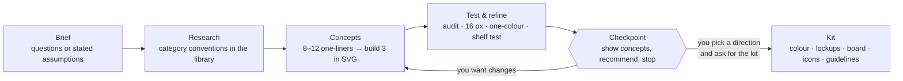

# Brand Identity Skill for AI Coding Agents

A comprehensive **brand-identity skill** that turns Claude, Codex, Gemini, Hermes, Grok, Cursor, Copilot or any other
coding agent — into a disciplined identity designer, from the first brief to
production-ready SVG files and brand guidelines.

- **Principles & process** — discovery and briefs, word mapping, choosing the right mark type, concepting,
  geometric construction, optical corrections (overshoot, bone effect, irradiation…), colour, typography, lockups,
  testing, presentation, delivery, redesigns and identity systems.
- **A reference library of 1,400+ real-world SVG logos**, each visually classified by mark type, technique,
  geometry, subject, typography, mood and industry — searchable from the command line and browsable in a local
  gallery. Used to study construction, map category conventions and avoid look-alikes (never to copy).
- **Dependency-free Python tools** — audit an SVG against logo principles, build concept overview sheets and test
  sheets (16 px pixel test, one-colour, reversed, squint, mirror, contexts, competitor shelf test), create client
  presentation boards with industry-specific mockups, render PNGs, and export a complete favicon / app-icon /
  web-manifest set.

**Contents:** [How it works](#how-it-works) · [Install](#install) ·
[Tests](#what-the-tests-catch) · [Use](#use) · [What's inside](#whats-inside) · [Library](#library-at-a-glance)

---

## How it works



The skill always **stops at the checkpoint**: it shows the concepts as one overview image with a recommendation and
offers the full kit. Nothing else is produced until you choose a direction — the kit is most of the work and only
makes sense for an approved idea.

---

## Install

The skill uses the open **Agent Skills** format (a folder with a `SKILL.md`; instructions are plain Markdown, tools are
plain Python), so it is not tied to one agent.

**Quick install** — copies the skill into every agent folder it finds, or the ones you name:
```bash
./install.sh                      # every agent already set up in your home folder
./install.sh claude codex hermes  # specific agents (claude codex gemini hermes opencode cursor agents)
./install.sh --project claude     # into ./.claude/skills of the current project instead
```

**Manual** — copy `skills/brand-identity` into your agent's skills folder:

| Agent | Personal (all projects) | Per project |
|---|---|---|
| Claude Code | `~/.claude/skills/brand-identity` | `.claude/skills/brand-identity` |
| Codex CLI | `~/.codex/skills/brand-identity` | `.codex/skills/brand-identity` |
| Gemini CLI | `~/.gemini/skills/brand-identity` (or `~/.agents/skills/`) | `.gemini/skills/brand-identity` |
| Hermes | `~/.hermes/skills/brand-identity` | see Hermes docs |
| OpenCode | `~/.config/opencode/skills/brand-identity` | `.opencode/skills/brand-identity` |
| Cursor | `~/.cursor/skills/brand-identity` | `.cursor/skills/brand-identity` |

**Agents without skill folders (Grok, Copilot, Aider, others)** — the root [`AGENTS.md`](AGENTS.md) tells any agent that
reads it to load `skills/brand-identity/SKILL.md` when a logo or brand request comes up. Open this repo in the agent, or
copy `AGENTS.md` and the `skills/` folder into your project. As a last resort, paste `SKILL.md` into the agent's rules
file.

**Claude.ai / Claude Desktop** — run `python3 tools/package_skill.py`, then upload `dist/brand-identity.zip` under
**Settings → Capabilities → Skills**. If the upload has a size limit, use `brand-identity-lite.zip` (everything except
the SVG files themselves).

**Requirements:** Python 3.8+ (standard library only) and file + shell access. A model that can view images works
best, because the skill renders its own drafts to PNG and checks them before showing you anything.


---

## What the tests catch

Every concept goes through `svg_audit.py` and `preview_sheet.py` before the checkpoint. The test sheet puts the
options side by side at 96 and 32 px, in one colour and reversed, then walks each one down a size ladder to 16 px.

The audit turns craft rules into checks. The same run, two files — the recommended lockup and the emblem that was not
recommended:

```text
$ python3 scripts/svg_audit.py a-lockup.svg b-emblem.svg

=== a-lockup.svg
viewBox 0 0 905 256 · aspect 3.535 (horizontal) · colours 1 · anchors 205
· INFO [complexity] 205 anchor points (library median 75, p75 155). Check every point earns its place.
production-readiness score: 99/100

=== b-emblem.svg
viewBox 0 0 256 256 · aspect 1.0 (square) · colours 1 · anchors 374
▲ WARN [complex] 374 anchor points — more than 95% of comparable reference logos (median 53).
▲ WARN [near-miss-angle] 8 straight edge(s) are 0.3–3° off a clean angle … (expected for type set on a curve)
▲ WARN [tiny-detail] 6 sub-shape(s) smaller than 1/48 of the canvas: 4.3×3.1 at (40,77) …
production-readiness score: 76/100
```

---

## Use

Just ask — the skill triggers on logo, wordmark, monogram, brand mark, app icon, favicon, rebrand and critique requests:

> *"Design a logo for **Harbor**, a savings app for first-time savers. It should feel calm and safe."*
> *"Here's our current logo (logo.svg) — critique it and suggest a refresh."*
> *"Give me three wordmark directions for a specialty coffee roaster."*
> *"Turn this symbol into favicon, app icon and one-colour versions, plus a one-page usage guide."*

Tools can also be run directly:
```bash
cd skills/brand-identity
python3 scripts/search_library.py --technique negative-space --exemplary
python3 scripts/search_library.py --industry payments-fintech --summary
python3 scripts/svg_audit.py my-logo.svg
python3 scripts/concept_sheet.py a.svg b.svg c.svg --names "A" "B" "C" --recommend 1 -o concepts.png
python3 scripts/preview_sheet.py my-logo.svg --refs-industry developer-tools -o preview.html
python3 scripts/render_png.py my-logo.svg --size 512 -o my-logo.png
python3 scripts/export_variants.py my-logo.svg --mono "#0F7C80" --icon-bg "#0F7C80" --web-icons
open assets/library/gallery.html      # browse the library visually
```
Requires Python 3.8+ (standard library only). PNG/ICO export uses whatever renderer is available: `cairosvg`,
`rsvg-convert`, Inkscape, a Chromium-based browser (Chrome, Edge, Brave) or macOS Quick Look.

## What's inside

```
skills/brand-identity/
├── SKILL.md                     # workflow, checkpoint, principles, red flags, tool guide
├── references/                  # loaded on demand
│   ├── principles.md            # the twelve principles, mnemonic model, simplicity, relevance, longevity
│   ├── discovery-brief.md       # question bank, brief template, word mapping
│   ├── mark-types.md            # wordmark → combination: pros, cons, decision guide
│   ├── visual-techniques.md     # geometry, grids, balance, optical corrections, negative space, gradients…
│   ├── color.md · typography.md · process.md · svg-construction.md
│   ├── testing-checklist.md · presentation-delivery.md · identity-system.md
│   ├── redesign.md · critique.md
│   └── library-guide.md         # library contents, data insights, curated examples by technique
├── scripts/
│   ├── concept_sheet.py         # one-image concept overview shown at the checkpoint
│   ├── search_library.py        # query the 1,400+ logo library (filters, --summary, --format paths)
│   ├── svg_audit.py             # structure, colours, complexity, near-miss angles, tiny details, centring
│   ├── preview_sheet.py         # HTML test sheet (sizes, backgrounds, treatments, contexts, shelf test)
│   ├── presentation_board.py    # client presentation with six industry-specific mockups per concept
│   ├── render_png.py            # SVG → transparent PNG at exact sizes, favicon.ico
│   ├── export_variants.py       # black / white / mono / square / favicon / app-icon, PNGs, full web-icon set
│   └── build_catalog.py         # maintainers: rebuild catalog, stats and gallery
├── templates/                   # brand-guidelines template, presentation spec example
└── assets/library/              # svg/ (1,400+ files), catalog.json, classifications.json, stats.json, gallery.html
```

## Library at a glance

1,400+ files · ≈1,200 brands · 233 brands with both a lockup and a standalone icon · mark types: abstract 24 %,
combination 21 %, pictorial 20 %, letterform 15 %, wordmark 10 %, emblem 4 %, mascot 4 %, lettermark 3 % · median
2 colours, 75 % use ≤ 3 · gradients in 19 % · 141 flagged as exemplary teaching examples. More in
[`references/library-guide.md`](skills/brand-identity/references/library-guide.md).

## License & trademarks

Skill text, scripts, templates and catalog data: [MIT](LICENSE). The logo files in `assets/library/svg/` are
trademarks of their respective owners, included for reference and education only and **not** covered by the MIT
license — see [TRADEMARKS.md](TRADEMARKS.md).
